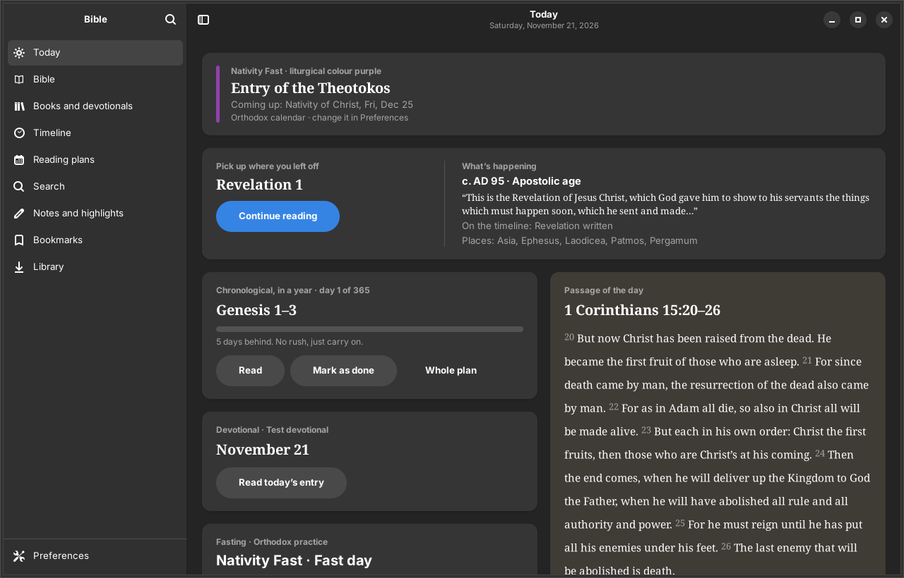
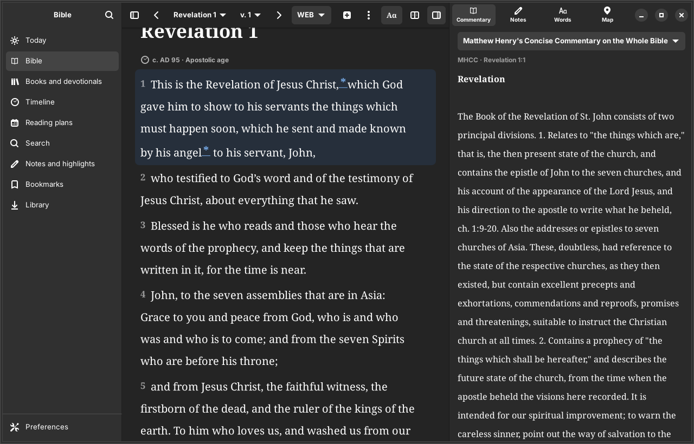
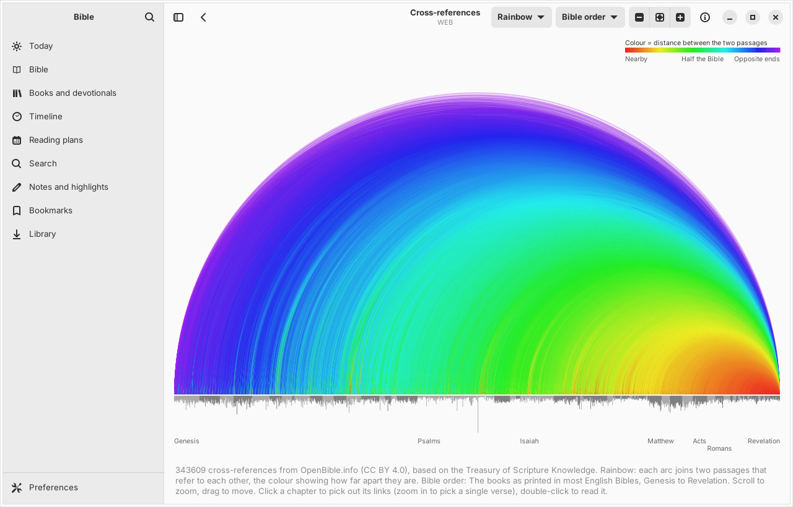
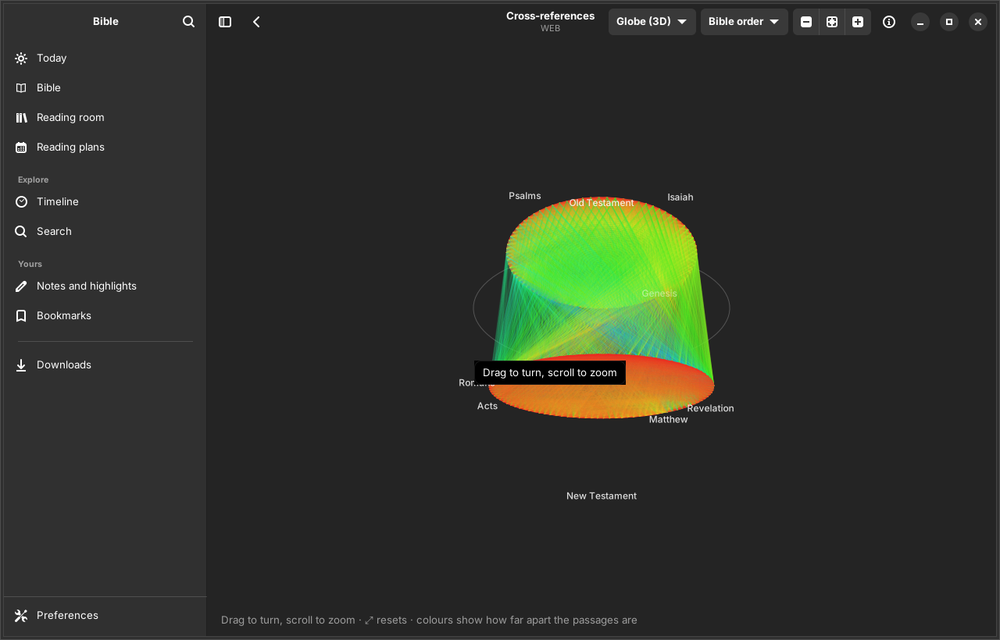
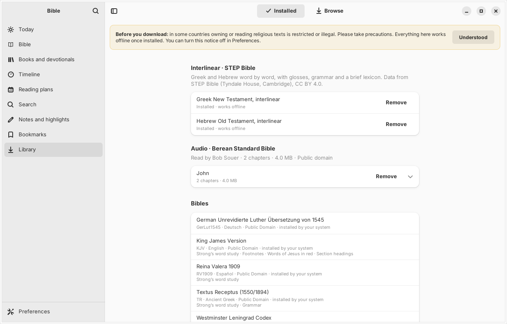

# Bible

[](https://github.com/fonzi/bible/releases)

An offline Bible app for GNOME. It works offline first, then reaches into
the wider Christian tradition as far as you want to take it. Written in Rust
with GTK 4 and libadwaita. Free software under the GPL-3.0-or-later.

**Website:** [fonzi.github.io/bible](https://fonzi.github.io/bible/) ·
**Download:** [latest release](https://github.com/fonzi/bible/releases/latest)

| Light | Dark |
|---|---|
|  |  |
|  |  |

## Why

Most Bible apps now want an account and a connection. The ones that still work offline tend to look like they belong to another decade. This one is meant to feel at home on a modern GNOME desktop and to keep working with the network switched off.

The background to each book (who wrote it, when, and for whom) shouldn’t sit behind a study Bible’s copyright. For now the introductions come from Wikipedia under an open licence, and more open sources will follow.

Start with the Bible, offline. Add the original languages, maps, history, the church year and the wider Christian tradition when you want them, and take it as far as you like.

## Other traditions and the Quran

Bible is a Christian study app. Downloads also lists texts from outside
historic Christianity, always below the Bible's own: the New World
Translation and the Book of Mormon (linked, since they can't be downloaded
freely), and the Quran in Arabic with an English translation and the Arabic's
pronunciation. They're there for study and comparison, for example for
apologetics or for understanding what neighbours and friends believe.

## Features

- **Read offline.** Download Bibles, commentaries, dictionaries, books and
  devotionals from SWORD repositories (CrossWire, eBible.org or any server
  you add), then read without a connection. You can read versions side by
  side, and the words of Christ can show in red.
- **Interlinear Greek and Hebrew.** Word-by-word data from STEP Bible
  (Tyndale House), with glosses, grammar in plain English, lexicon entries
  and every occurrence of a word.
- **Church fathers.** The Ante-Nicene and Nicene and Post-Nicene Fathers,
  37 volumes from Clement and Ignatius to Augustine, Chrysostom and the
  councils, downloaded one at a time from the Christian Classics Ethereal
  Library and read offline.
- **Cross-reference map.** OpenBible.info's 343,000 cross-references drawn as
  arcs. Zoom down to a single verse and see everything that meets there. You
  can also view them as a circle, a matrix, or in 3D as a cube or a globe you turn by hand, and order the books by
  events, date written, writer, language, culture, genre or literary form.
- **Introductions to every book.** Built in for the 66 books and the 18
  deuterocanonical books (Apocrypha), with each book's places on a map and
  its events on a timeline. You can also download the full Wikipedia article
  with its pictures, which then reads offline.
- **Notes and highlights.** Six named colours, notes kept as plain Markdown
  files you own (Obsidian-compatible), bookmarks with tags, and export.
- **Today.** The church day for your tradition (Catholic, Orthodox, Anglican,
  Lutheran, Reformed and others), a passage of the day, today in church
  history, your reading plan, and an optional fasting calendar.
- **Listen.** Chapter audio for the Berean Standard Bible, downloaded per
  chapter, with GNOME media controls.
- **Also:** reading plans, a timeline from the patriarchs to the apostles,
  maps, word study, presentation mode, GNOME Shell search, classic
  printed-Bible typography, and an optional splash screen and startup sound.

| Light | Dark |
|---|---|
|  |  |
|  |  |
|  |  |
|  |  |

## Install

### Requirements

GTK 4.14 or newer and libadwaita 1.5 or newer. That means:

| Works | Too old |
|---|---|
| Ubuntu 24.04 and later, Pop!_OS 24.04, Linux Mint 22, Debian 13, Fedora 40+, Arch | Ubuntu 22.04, Pop!_OS 22.04, Debian 12: use the Flatpak below |

On a system that's too old, apt refuses the package and changes nothing, so
it can't break your system. (If you installed it with `dpkg -i` and it was
left half-installed, `sudo apt --fix-broken install` removes it again.)

### Ubuntu, Debian, Pop!_OS, Mint

Download the `.deb` from the [latest release](https://github.com/fonzi/bible/releases/latest), then:

```sh
sudo apt install ./bible-app_*_amd64.deb
```

### Any distribution, including older ones (Flatpak)

The Flatpak brings its own GNOME libraries, so it runs on Pop!_OS and
Ubuntu 22.04, Debian 12 and most other distributions. Download the
`.flatpak` from the [latest release](https://github.com/fonzi/bible/releases/latest), then:

```sh
flatpak remote-add --if-not-exists --user flathub https://dl.flathub.org/repo/flathub.flatpakrepo
flatpak install --user ./bible-app-*.flatpak
```

The first install also fetches the GNOME runtime (a few hundred MB, shared
with other GNOME Flatpaks). Pop!_OS has Flathub set up already, so the first
line can be skipped there.

### Arch Linux

A PKGBUILD that builds the latest release from source:

```sh
git clone https://github.com/fonzi/bible.git
cd bible/packaging/arch
makepkg -si
```

Modules install into `~/.sword`, so other SWORD apps share them.

### Windows and macOS (untested, at your own risk)

Bible is made for GNOME first. Each release also has Windows and macOS zips,
named `_untested`: they're built and pass the tests automatically, but we have
no Windows PC or Mac to try them on. There are no plans to support them:
use them at your own risk. Issues reported from Windows or macOS are closed
automatically; pull requests that fix them are welcome.

- **Windows:** unzip and run `bin\bible-app.exe`. The app isn't code-signed
  (a certificate costs money every year), so SmartScreen may say it
  "protected your PC". Choose *More info*, then *Run anyway*.
- **macOS** (Apple Silicon): unzip and drag Bible.app to Applications. It
  isn't notarized by Apple, so the first time macOS refuses to open it; then
  choose *Open Anyway* in System Settings, Privacy & Security.

## Build from source

```sh
sudo apt install build-essential libgtk-4-dev libadwaita-1-dev \
    libgstreamer1.0-dev libssl-dev pkg-config
cargo build --release
cargo test --workspace
# Debian package
cargo install cargo-deb && cargo deb -p bible-app
```

## Layout

- `crates/bible-core`: versification, references, notes, church year,
  plans, calendars and built-in data (no UI)
- `crates/bible-sword`: an independent GPL-3 reader and installer for SWORD
  module formats
- `crates/bible-step`: STEP Bible interlinear and lexicon data
- `app`: the GTK interface
- `tools`: the scripts that build the bundled data
- `docs/TODO.md`: what's planned next

## Credits

Data and media come from many generous projects. The full list is on the
About page in the app:

- STEP Bible: Tyndale House, Cambridge, CC BY 4.0
- OpenBible.info: cross-references and places, CC BY 4.0
- Wikipedia: book introductions and articles, CC BY-SA 4.0
- Wikimedia Commons: pictures, and the sung Kyrie by Paterm, CC BY-SA 3.0
- Natural Earth: map outlines, public domain
- Berean Standard Bible audio: read by Bob Souer, public domain
- CrossWire Bible Society and eBible.org: SWORD modules, each under its
  own licence

## Licence

GPL-3.0-or-later. See [LICENSE](LICENSE).
