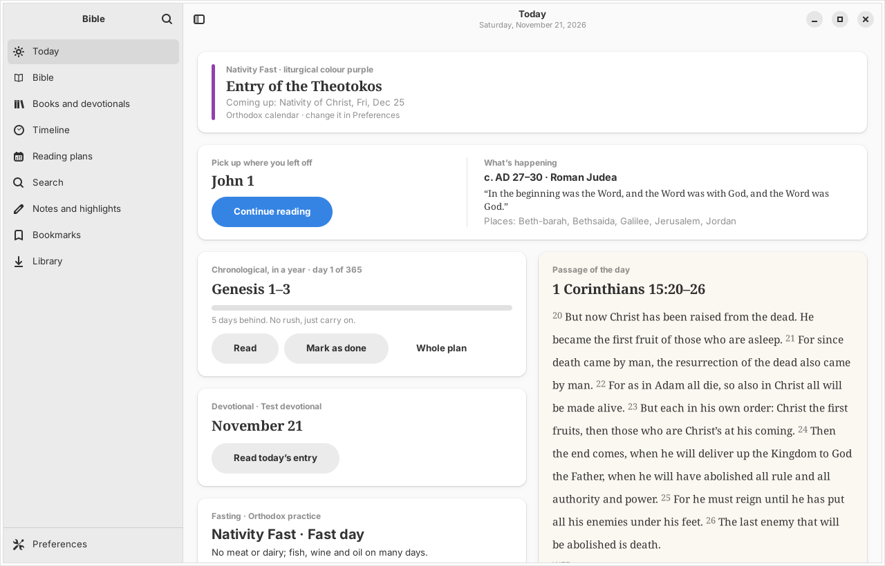
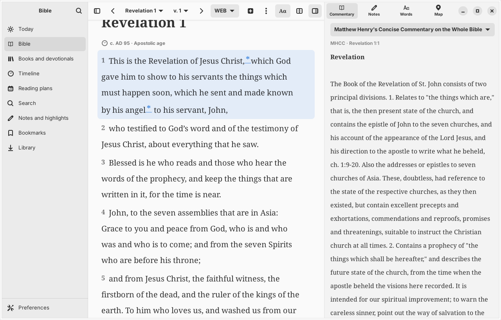
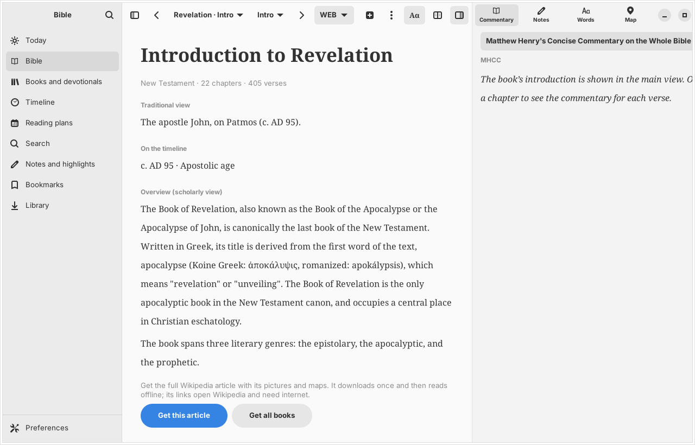
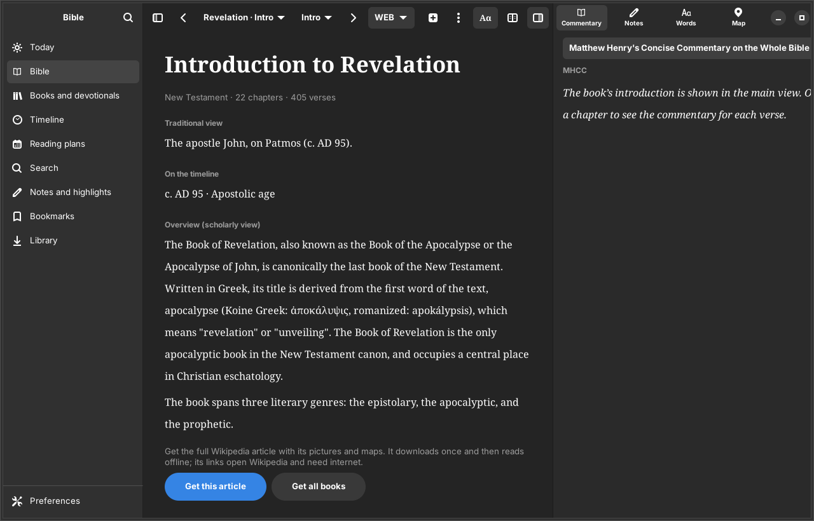
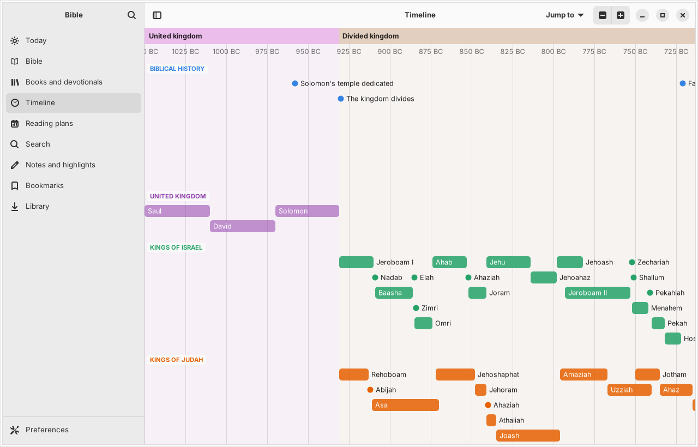
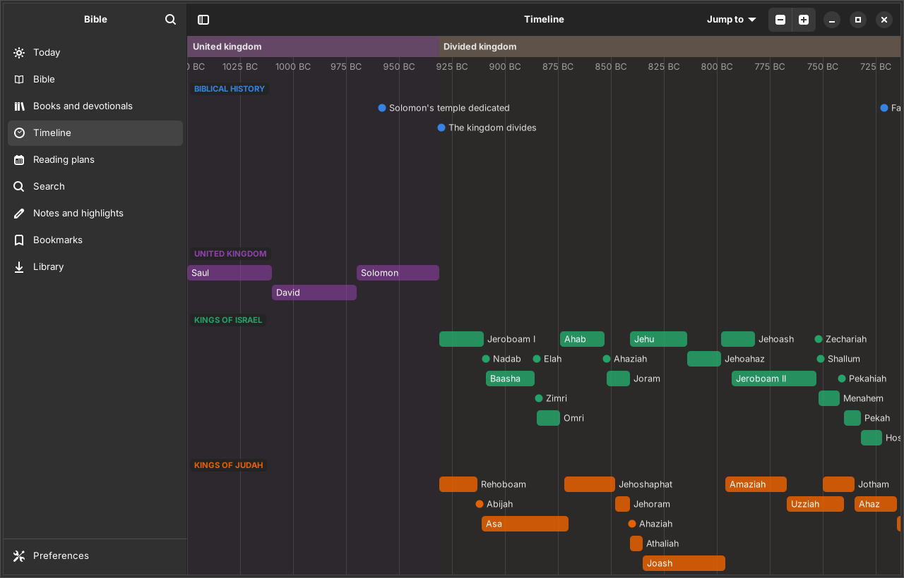
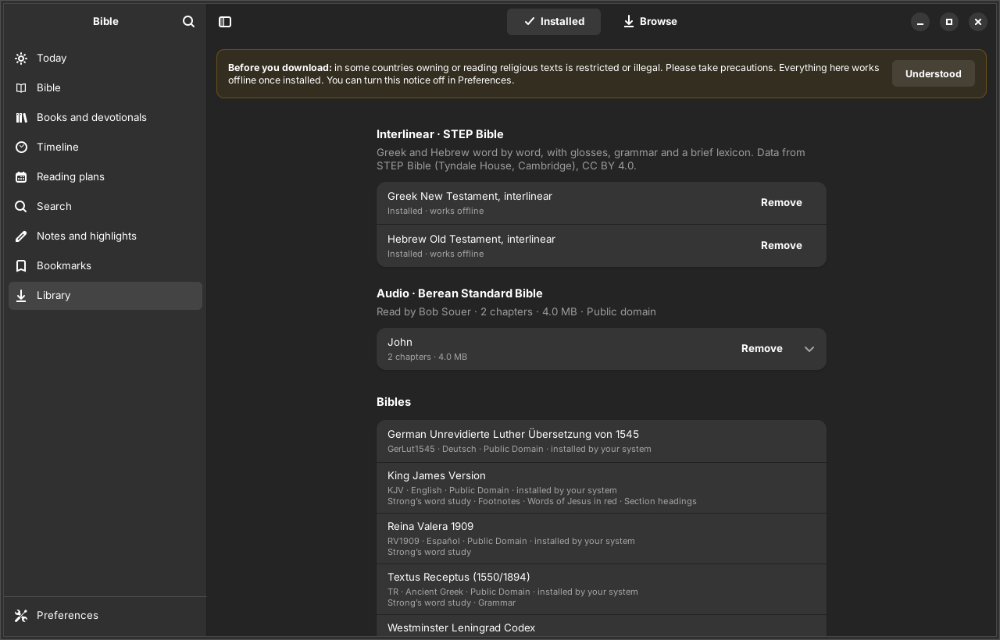

# Bible

An offline Bible app for GNOME. It works offline first, then reaches into
the wider Christian tradition as far as you want to take it. Written in Rust
with GTK 4 and libadwaita. Free software under the GPL-3.0-or-later.

**Website:** [fonzi.github.io/bible](https://fonzi.github.io/bible/) ·
**Download:** [latest release](https://github.com/fonzi/bible/releases/latest)

| Light | Dark |
|---|---|
|  |  |
|  |  |

## Features

- **Read offline.** Download Bibles, commentaries, dictionaries, books and
  devotionals from SWORD repositories (CrossWire, eBible.org or any server
  you add), then read without a connection. You can read versions side by
  side, and the words of Christ can show in red.
- **Interlinear Greek and Hebrew.** Word-by-word data from STEP Bible
  (Tyndale House), with glosses, grammar in plain English, lexicon entries
  and every occurrence of a word.
- **Cross-reference map.** OpenBible.info's 343,000 cross-references drawn as
  arcs. Zoom down to a single verse and see everything that meets there. You
  can also view them as a circle or a matrix, and order the books by
  events, date written, writer, language, culture, genre or literary form.
- **Introductions to every book.** Built in for the 66 books and the 18
  deuterocanonical books (Apocrypha), with each book's places on a map and
  its events on a timeline. You can also download the full Wikipedia article
  with its pictures, which then reads offline.
- **Notes and highlights.** Six named colours, notes kept as plain Markdown
  files you own (Obsidian-compatible), bookmarks with tags, and export.
- **Today.** The church day for your tradition (Catholic, Orthodox, Anglican,
  Lutheran, Reformed and others), a passage of the day, today in church
  history, your reading plan, and an optional fasting calendar.
- **Listen.** Chapter audio for the Berean Standard Bible, downloaded per
  chapter, with GNOME media controls.
- **Also:** reading plans, a timeline from the patriarchs to the apostles,
  maps, word study, presentation mode, GNOME Shell search, classic
  printed-Bible typography, and an optional splash screen and startup sound.

| Light | Dark |
|---|---|
|  |  |
|  |  |
|  |  |
|  |  |

## Install

Download the `.deb` from the [latest release](https://github.com/fonzi/bible/releases/latest), then:

```sh
sudo apt install ./bible-app_*_amd64.deb
```

It needs GTK 4.14+ and libadwaita 1.5+ (Ubuntu 24.04+, Debian 13+).
Modules install into `~/.sword`, so other SWORD apps share them.

## Build from source

```sh
sudo apt install build-essential libgtk-4-dev libadwaita-1-dev \
    libgstreamer1.0-dev libssl-dev pkg-config
cargo build --release
cargo test --workspace
# Debian package
cargo install cargo-deb && cargo deb -p bible-app
```

## Layout

- `crates/bible-core`: versification, references, notes, church year,
  plans, calendars and built-in data (no UI)
- `crates/bible-sword`: an independent GPL-3 reader and installer for SWORD
  module formats
- `crates/bible-step`: STEP Bible interlinear and lexicon data
- `app`: the GTK interface
- `tools`: the scripts that build the bundled data
- `docs/TODO.md`: what's planned next

## Credits

Data and media come from many generous projects. The full list is on the
About page in the app:

- STEP Bible: Tyndale House, Cambridge, CC BY 4.0
- OpenBible.info: cross-references and places, CC BY 4.0
- Wikipedia: book introductions and articles, CC BY-SA 4.0
- Wikimedia Commons: pictures, and the sung Kyrie by Paterm, CC BY-SA 3.0
- Natural Earth: map outlines, public domain
- Berean Standard Bible audio: read by Bob Souer, public domain
- CrossWire Bible Society and eBible.org: SWORD modules, each under its
  own licence

## Licence

GPL-3.0-or-later. See [LICENSE](LICENSE).
